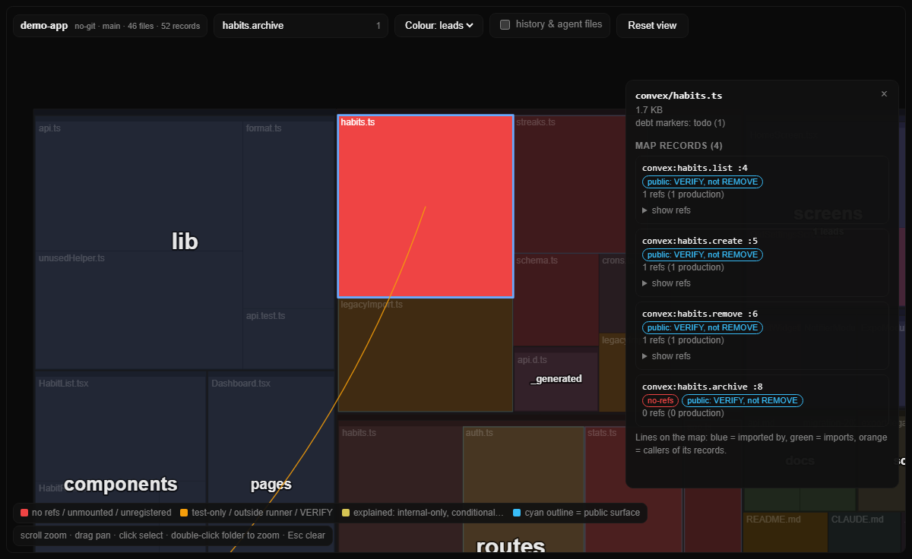
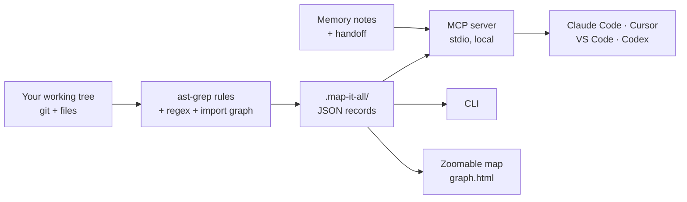

<p align="center">
  
</p>

<p align="center">
  <a href="https://github.com/peterish8/map-it-all/actions/workflows/ci.yml"></a>
  <a href="LICENSE"></a>
  
  
  
  
</p>

<p align="center">
  <b>Your agent re-learns your repo every session, trusts notes the code has outgrown, and deletes things it cannot see are used.<br>MAP-IT-ALL fixes that, locally, in a few hundred tokens.</b>
</p>

<p align="center">
  <a href="#quickstart">Quickstart</a> ·
  <a href="#what-you-get">What you get</a> ·
  <a href="#connect-your-agent">Connect your agent</a> ·
  <a href="#see-it-work">Example</a> ·
  <a href="#tools">Tools</a> ·
  <a href="#faq">FAQ</a> ·
  <a href="docs/">Docs</a>
</p>

<p align="center">
  
  <br><sub>The bundled demo project. Red = no references, orange = verify, cyan outline = public surface. Click a file to see who calls it.</sub>
</p>

## Why

Solo developers working with coding agents keep hitting the same walls:

| The problem | What the research and reports say | What MAP-IT-ALL does |
| --- | --- | --- |
| Agents add code instead of changing it, break parts they cannot see, lose the plot in a large repo | [Columbia DAPLab's 9 failure patterns of coding agents](https://daplab.cs.columbia.edu/general/2026/01/08/9-critical-failure-patterns-of-coding-agents.html) (repeated code, codebase awareness, refactoring) | `connections` shows the blast radius before the edit; `find` and `symbol` find the helper that already exists |
| Every new session re-explains the project and burns input tokens | A constant complaint in developer threads; context files drift out of date | `brief` at session start, `handoff` at session end |
| Memory goes stale as the code changes | [STALE: can LLM agents know when their memories are outdated?](https://arxiv.org/abs/2605.06527), [Dosu on pruning stale agent memory](https://dosu.dev/articles/prune-stale-agent-memory) | Notes carry file hashes; `recall` flags `stale` and `orphaned` notes |
| Too many MCP tools cost tokens on every request and make tool choice worse | [MCP tool overload](https://dev.to/thedailyagent/mcp-tool-overload-why-more-tools-make-your-agent-worse-5a49) reports ~42,000 tokens of definitions for GitHub's official server | 4 to 11 tools in three profiles: **~670 / ~1,150 / ~1,270 tokens** (measured, `map-it-all tokens`) |
| Dead code piles up, docs describe deleted files | [Developers report](https://news.ycombinator.com/item?id=48770319) that agents add and rarely delete | `leads`, `diff`, and a docs-drift check |
| Shell output floods the context | [RTK](https://github.com/rtk-ai/rtk) | `doctor` detects it and prints the setup ([docs/rtk.md](docs/rtk.md)) |

## What you get

- **A session brief** (~450 tokens): git state, stack, layout, most-imported files, public surface, cleanup leads, your last handoff and memory notes. No more re-explaining the project.
- **Connections and blast radius.** Who imports this file, what it imports, and who calls the route or function it registers, including callers an import graph cannot see: `'module:fn'` strings, wrapper helpers, URL literals, Kotlin/JS native bridges.
- **Memory that knows when it is stale.** Notes are anchored to files by content hash. Change the file and the note is flagged before an agent trusts it.
- **Cleanup leads with the right amount of fear.** No references, test-only references, unmounted routes, unregistered native modules, tests no runner executes, docs pointing at deleted files. Anything an installed client or external caller could still reach is marked `public`: **VERIFY, never REMOVE**.
- **A session diff.** "What did this session just orphan?" in one call.
- **A zoomable map you can open** (the picture above).
- **Local and cheap.** No network, no API keys, no telemetry. One runtime dependency, [ast-grep](https://ast-grep.github.io). Works with any MCP client: Claude Code, Cursor, VS Code, Codex.

It does **not** replace a language server or a call-graph tool. For exact, type-aware call graphs, run one next to it (graft, [codebase-memory-mcp](https://github.com/DeusData/codebase-memory-mcp), Serena, CodeGraph). MAP-IT-ALL covers what those do not: registration and liveness facts, session memory and the brief. See the [comparison](#how-it-compares).

## Quickstart

Needs Node 20 or newer and git.

**1. See it first (10 seconds, touches nothing of yours):**

```bash
npx -y github:peterish8/map-it-all demo --open
```

That maps a bundled sample project into your temp folder and opens the zoomable map.

**2. Connect it to your agent** (from your project folder):

```bash
# macOS / Linux / WSL / Git Bash
claude mcp add map-it-all -- npx -y github:peterish8/map-it-all mcp
```

```powershell
# Windows PowerShell: quote the double dash, and run npx through cmd
claude mcp add map-it-all '--' cmd /c npx -y github:peterish8/map-it-all mcp
```

> PowerShell swallows an unquoted `--`, and Claude Code then fails with `error: unknown option '-y'`. If you would rather not think about quoting in any shell, let the tool write the config: `npx -y github:peterish8/map-it-all init --agent claude --npx --write` (Claude Code asks you to approve a project-level server the first time).

Not on Claude Code? See [Connect your agent](#connect-your-agent).

**3. Ask your agent to call `brief`.** That is the whole setup. The first call builds the map (a few seconds); after that it rebuilds only when your tree changes.

<details>
<summary><b>Prefer a local clone?</b></summary>

```bash
git clone https://github.com/peterish8/map-it-all.git
cd map-it-all && npm install            # installs ast-grep, the only dependency

cd /path/to/your/project
node /path/to/map-it-all/bin/map-it-all.mjs doctor       # checks Node, git, ast-grep, Knip, RTK
node /path/to/map-it-all/bin/map-it-all.mjs init --write # writes the MCP config and a .gitignore entry
node /path/to/map-it-all/bin/map-it-all.mjs view --open  # the zoomable map
```

`init` without `--write` only prints. It never edits your agent settings.
</details>

## Connect your agent

`map-it-all init --agent <claude|cursor|vscode|codex|all> [--npx] [--write]` prints (or, with `--write`, merges) the right config for your OS and keeps any servers you already have. By hand:

<details open>
<summary><b>Claude Code</b></summary>

```bash
# macOS / Linux / WSL / Git Bash, from your project folder
claude mcp add map-it-all -- npx -y github:peterish8/map-it-all mcp

# Windows PowerShell: npx runs through cmd, and the double dash must be quoted
claude mcp add map-it-all '--' cmd /c npx -y github:peterish8/map-it-all mcp

# any shell, no `--` to get wrong: the tool writes .mcp.json for you
npx -y github:peterish8/map-it-all init --agent claude --npx --write
```

Start every session with the brief by adding a `SessionStart` hook to `.claude/settings.json`:

```json
{
  "hooks": {
    "SessionStart": [
      { "hooks": [{ "type": "command", "command": "npx -y github:peterish8/map-it-all session-start", "timeout": 120000 }] }
    ]
  }
}
```

The hook rebuilds only if HEAD or the working tree changed, saves the baseline that `diff` compares against, and prints the brief, which Claude Code adds to the session.
</details>

<details>
<summary><b>Cursor</b></summary>

`.cursor/mcp.json`:

```json
{
  "mcpServers": {
    "map-it-all": { "command": "npx", "args": ["-y", "github:peterish8/map-it-all", "mcp"] }
  }
}
```
</details>

<details>
<summary><b>VS Code</b></summary>

`.vscode/mcp.json` (note `servers`, not `mcpServers`):

```json
{
  "servers": {
    "map-it-all": { "command": "npx", "args": ["-y", "github:peterish8/map-it-all", "mcp", "--root", "${workspaceFolder}"] }
  }
}
```
</details>

<details>
<summary><b>Codex</b></summary>

`~/.codex/config.toml`:

```toml
[mcp_servers.map-it-all]
command = "npx"
args = ["-y", "github:peterish8/map-it-all", "mcp", "--root", "/absolute/path/to/your/project"]
```
</details>

By default the server maps the directory the client starts it in. Use `--root <dir>` or `MAP_IT_ALL_ROOT` to point elsewhere. Add `--profile minimal` to expose four tools (about 670 tokens of definitions) instead of nine. More in [docs/agents.md](docs/agents.md).

Then add three lines to your `CLAUDE.md` / `AGENTS.md` ([snippet](examples/CLAUDE.md.snippet)):

```markdown
- Start each session with the map-it-all `brief` tool. Before editing or deleting, use `connections` and `find`.
- Zero refs is a lead, never proof. `public` records may be used by installed clients: VERIFY, do not remove.
- Save durable learnings with the `memory` tool, anchored to files; call `handoff` before ending.
```

## See it work

Real output from the bundled demo project (`map-it-all demo`).

**`brief`**: what an agent needs to start, in ~450 tokens.

```text
# Session brief: demo-app

Stack: convex: 9 functions (7 public), 4 tables · express: 11 routes (2 conditional) · expo/android: 2 screens, 2 native modules, 3 kotlin classes
Layout:
  web  11 files (tsx/ts)
  convex  10 files (ts)
  mobile  8 files (kt/tsx)
  server  7 files (ts)
Most-imported files (change with care):
  web/src/lib/api.ts  ×2
Public surface (installed clients may still call it: VERIFY before removing): 7 convex-function, 1 convex-http, 11 express-route
Cleanup leads: 5 express-route, 3 convex-function, 2 kotlin-class, 2 npm-script, 2 test-file, 2 env-var
Docs pointing at missing paths: 1 doc(s); worst README.md (2). Do not trust those docs' file references.
```

**`leads`**: what looks unused, and what needs care.

```text
convex-function (3)
  convex:streaks.forHabit   convex/streaks.ts:4         [no-refs] public
  convex:habits.archive     convex/habits.ts:8          [no-refs] public
  convex:legacyImport.run   convex/legacyImport.ts:4    [test-only] public
native-module (1)
  native-module:HabitWidget mobile/android/.../HabitWidgetModule.kt:2  [not-in-ExpoModulesPackageList]
express-route (5)
  express:GET /api/admin/users   server/routes/admin.ts:4   [conditional-mount,no-refs,undocumented] public
  express:GET /api/stats/export  server/routes/stats.ts:4   [no-refs,undocumented] public
```

**`connections`**: the blast radius, with the warning an agent needs.

```text
$ map-it-all connections convex:habits.archive
No by-name callers recorded for convex:habits.archive [no-refs] public: installed or external clients may still call it

$ map-it-all connections web/src/lib/api.ts --direction in
IN: depends on this file (blast radius) (3)
  d1  web/src/hooks/useHabits.ts:2
  d1  web/src/lib/api.test.ts:1 [test]
  d1  web/src/pages/Settings.tsx:1
```

**`memory recall`**: a note that notices the code moved.

```text
health-route-stays-above-the-routers-3fdf2  [decision] STALE
  Health route stays above the routers
  Load balancers hit /health before auth is mounted.
  anchors: server/app.ts
  ! server/app.ts changed since this note was written: verify before relying on it
```

## The loop

1. **Start:** the `SessionStart` hook (or the agent) calls `brief`.
2. **Before editing or deleting:** `connections` and `find`. `public` means installed clients or external callers: VERIFY.
3. **While working:** `memory` → `remember` for a decision or a gotcha, anchored to the files it is about.
4. **After a change:** `diff` lists records that just lost their last production reference.
5. **End:** `handoff` → `save` with a summary and next steps. The next brief shows it, and flags files that changed since.

## Tools

| Tool | What it answers |
| --- | --- |
| `brief` | What do I need to know to start? |
| `find` | Which routes, functions, native modules, scripts or docs match this? Filter by flag or public surface. |
| `file` | Everything about one file: records, importers, imports, debt, anchored notes |
| `connections` | Who depends on this, what does it depend on, who calls what it registers? (`format: "mermaid"` draws it) |
| `leads` | What looks unused or broken, and what needs VERIFY? |
| `symbol` | Where is this name declared and mentioned? (name-based, not type-aware) |
| `diff` | What did this session newly orphan? |
| `memory` | `remember`, `recall`, `confirm`, `forget`, `list`: notes anchored to files |
| `handoff` | `save` at the end, `read` at the start |
| `refresh`, `view` | Rebuild now (optionally with Knip); path of the zoomable map |

Profiles (`--profile`): `minimal` is brief, find, connections, memory; `standard` (default) adds file, leads, symbol, diff, handoff; `full` adds refresh and view. Every tool is also a CLI command, so the terminal and the agent always agree.

## CLI

```text
map-it-all demo [--open]                try it on a bundled sample, touching nothing of yours
map-it-all init [--agent ..] [--npx] [--write]   print or write the MCP config and hook
map-it-all doctor                       check Node, git, ast-grep, Knip, RTK, the map
map-it-all build [--with-knip]          build the map (a few seconds)
map-it-all view [--open]                the zoomable map page
map-it-all brief | session-start        the session brief | rebuild, snapshot, brief (a hook)
map-it-all query <text> [--kind k] [--flag f]
map-it-all file <path> | connections <target> [--direction in|out|both] [--depth n] [--mermaid]
map-it-all leads [--kind k] [--flag f] [--public] | symbol <name> | diff
map-it-all memory list|recall <q>|forget <id> | handoff | tokens
map-it-all check                        exit 1 if a pack's rules drifted (for CI)
map-it-all mcp [--profile minimal|standard|full]
```

`map-it-all <command> --help` for one command. Run `map-it-all tokens` to see what the MCP tool definitions cost on your install.

## What gets mapped

**Generic, any JS/TS repo:** an import graph with real alias resolution (tsconfig `paths` and `extends`, workspace packages), docs and their inbound links, **docs drift** (docs naming files that no longer exist; fenced examples skipped), debt markers, npm scripts and script files nothing references, **tests outside every runner glob**, env vars read but set nowhere in the checkout, web workers.

**Framework packs, auto-detected:**

| Pack | Detected from | Maps |
| --- | --- | --- |
| **convex** | a `convex/` folder with `schema.ts` | functions and every caller form (`api.x.y`, `internal.x.y`, `anyApi`, `'module:fn'` strings, `` `module:${name}` `` wrappers, crons, runbook mentions), tables with reads and writes, HTTP routes |
| **express** | files that call `express()` | routes with full mount paths (nested, default-export, factory and same-file routers, conditional mounts), URL callers across the repo, whether a doc mentions the route |
| **expo** | a `package.json` with `expo` or `react-native` next to a Kotlin `android/` folder | screens, native modules (Kotlin `Name("X")` against JS callers against the package list), Kotlin classes |

Details, limits and how to write a pack: [docs/packs.md](docs/packs.md).

## Memory that knows when it is stale

```text
memory remember  title:   "Health route stays above the routers"
                 body:    "Load balancers hit /health before auth is mounted."
                 kind:    decision
                 anchors: ["server/app.ts"]
```

`recall` re-hashes every anchor against the working tree: `fresh`, `stale` (an anchored file changed) or `orphaned` (it is gone). `confirm` re-verifies after the agent checked. Notes are small JSON files under `.map-it-all/memory/`; set `memoryDir` to commit them and share with a team. [docs/memory.md](docs/memory.md)

## How it works



Code structure comes from [ast-grep](https://ast-grep.github.io) rules (tree-sitter, so comments and strings never cause false hits). A pack only reports what a plain regex count also sees: `map-it-all check` compares them and exits 1 on drift, so a rule that stops matching is loud. Everything is plain JSON and Markdown you can read.

## Pair with RTK

MAP-IT-ALL shrinks what an agent has to *read about your code*. [RTK](https://github.com/rtk-ai/rtk) shrinks what comes back from the *commands it runs*. They do not overlap and neither needs the other. `map-it-all doctor` detects it and prints the install line for your OS ([docs/rtk.md](docs/rtk.md)).

## Configuration

Zero config works. To override detection, add `map-it-all.config.json` at the repo root:

```json
{
  "historyDirs": [".planning", "archive"],
  "ignore": ["**/vendor/**"],
  "driftIgnore": ["^\\.mcp\\.json$"],
  "convex": { "dir": "convex" },
  "express": { "appFiles": ["server/app.ts"] },
  "expo": { "dir": "apps/mobile" }
}
```

[Every option](docs/packs.md) · [example file](examples/map-it-all.config.example.json)

## How it compares

|  | MAP-IT-ALL | Call-graph servers (graft, codebase-memory-mcp, CodeGraph, Serena) | General agent-memory services (Mem0, Zep, Letta, Cognee) | RTK |
| --- | --- | --- | --- | --- |
| Answers | What registers, references and imports what; what is safe to touch; where we left off | Exact symbol-level callers and definitions | What was said or decided across conversations | Shorter command output |
| Memory is tied to code | Yes, by file hash; flags stale | Not their focus | Not by file hash, typically | No |
| Marks what shipped clients may still call (VERIFY, not REMOVE) | Yes (`public`) | Not their focus | Not their focus | No |
| Needs a model, vector store or API key | No | No | Typically yes | No |
| Tool-definition cost | ~670 to ~1,270 tokens | Varies by server | Varies | n/a (CLI hook) |

They are complements: run a call-graph server for exact call graphs, MAP-IT-ALL for the brief, registration facts and memory, RTK for shell output.

## FAQ

<details>
<summary><b>Does it send my code anywhere?</b></summary>
No. It makes no network requests and has no telemetry. It reads your project folder, runs <code>git</code> and ast-grep locally, and writes to <code>.map-it-all/</code>. See <a href="SECURITY.md">SECURITY.md</a>.
</details>

<details>
<summary><b>"No references" means I can delete it, right?</b></summary>
No, and the tool is built to say so. Zero refs is a lead. Routes, public Convex functions and similar are marked <code>public</code> because installed mobile builds, desktop apps and outside callers may still use them; no caller in the repo means VERIFY. A static map cannot see strings built at runtime or callers outside the repo.
</details>

<details>
<summary><b>Does it replace graft, codebase-memory-mcp or a language server?</b></summary>
No. Those give exact, type-aware call graphs. MAP-IT-ALL gives registration and liveness facts, the session brief and anchored memory, and its <code>symbol</code> tool is name-based. Use them together.
</details>

<details>
<summary><b>How big a repo can it handle, and how slow is it?</b></summary>
On a real 2,500-file TypeScript/Kotlin monorepo (Convex, Express, Expo) a full build takes about 7 seconds and parity checks pass (Convex 134/134 functions, Express 93/93 routes). It rebuilds only when HEAD or the working tree changed.
</details>

<details>
<summary><b>My stack is not Convex, Express or Expo.</b></summary>
You still get the import graph, docs links and drift, scripts, tests outside runners, env vars, debt and the brief, memory and handoff. Framework packs are small; see <a href="docs/packs.md#writing-a-new-pack">writing a new pack</a> or open a <a href="https://github.com/peterish8/map-it-all/issues/new?template=feature_request.yml">framework request</a> with a snippet of how routes are registered.
</details>

<details>
<summary><b>Why not a vector database for memory?</b></summary>
Project memory asks "what did we decide about this file, and is that still true?" Anchors plus text search answer both with nothing to host and every note readable by a human. See <a href="docs/memory.md">docs/memory.md</a>.
</details>

<details>
<summary><b>Where do the map, notes and handoff live?</b></summary>
In <code>.map-it-all/</code> in your project (gitignored by <code>init --write</code>). Set <code>memoryDir</code> to keep notes somewhere tracked.
</details>

<details>
<summary><b>Windows?</b></summary>
Yes. It was built and tested on Windows, and CI runs on Windows and Linux. For MCP clients, run <code>npx</code> through <code>cmd /c</code>; <code>init --npx</code> writes that for you.
</details>

## Roadmap

Ideas, not promises. Open an issue to vote or to propose.

- More packs: Next.js route handlers, Hono/Fastify, NestJS, tRPC
- Convex nested module folders
- Optional import of SCIP indexes for exact call edges
- A `watch` mode and a lighter incremental build for very large repos
- Publish to npm and the MCP registry

## Contributing

Issues and pull requests are welcome, especially **a wrong or missing result with a small project that shows it**. See [CONTRIBUTING.md](CONTRIBUTING.md); please read the [Code of Conduct](CODE_OF_CONDUCT.md). Report security problems privately ([SECURITY.md](SECURITY.md)).

```bash
git clone https://github.com/peterish8/map-it-all.git && cd map-it-all
npm install && npm test       # 21 tests: packs, import resolution, memory, MCP protocol, CLI
```

## Acknowledgements

Built on [ast-grep](https://ast-grep.github.io) (code structure) and informed by [Knip](https://knip.dev) (unused files and exports, an optional bridge), [RTK](https://github.com/rtk-ai/rtk) (command-output compression), and the research and reports linked above.

## License

[MIT](LICENSE)
